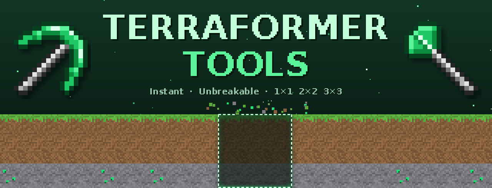
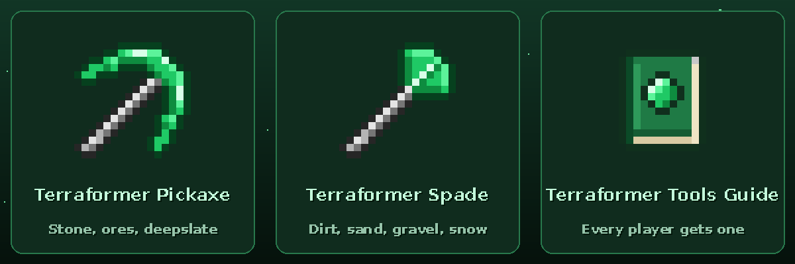
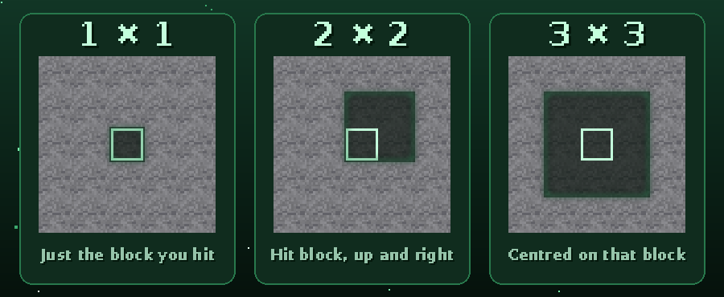
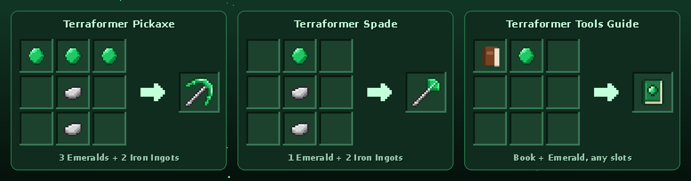

<p align="center">
  
</p>

<p align="center">
  <a href="https://github.com/sculley/terraformer-tools/releases/latest"></a>
  <a href="https://github.com/sculley/terraformer-tools/actions/workflows/release.yml"></a>
  
  
</p>

**Terraformer Tools** is a lightweight Minecraft Bedrock add-on for reshaping the land fast. An emerald **pickaxe** and **spade** that mine **instantly**, **never break**, and dig a **1 × 1, 2 × 2 or 3 × 3** area with every block you break. Flatten hills, dig shafts, carve tunnels and clear whole beaches in minutes.

No experimental toggles. Works on every Bedrock platform, including console via Realms.

<p align="center">
  
</p>

## ⬇️ Download

Grab **`Terraformer_Tools-x.y.z.mcaddon`** from the [latest release](https://github.com/sculley/terraformer-tools/releases/latest).

## ✨ Features

- **Instant mining**: every block the tool is meant for breaks in a single hit, even obsidian.
- **Unbreakable**: no durability, so the tools never wear out.
- **1 × 1, 2 × 2 or 3 × 3**: pick the size from a menu, and each tool remembers its own setting.
- **Pickaxe and spade**: the pickaxe takes stone, ores, deepslate, netherrack and metal blocks. The spade takes dirt, grass, sand, gravel, clay and snow. Both mine at diamond level, so obsidian and ancient debris drop.
- **Safe by design**: the pickaxe's area only takes pickaxe blocks and the spade's only takes spade blocks, so chests, logs, glass and your builds stay put. Bedrock, portals, barriers and command blocks are never touched. Water and lava are left in place.
- **Normal drops**: blocks broken by the area drop their items just like mining them. In Creative nothing drops.
- **Terraformer Tools Guide**: every player gets one on first join. It explains everything, including the recipes, in-game.

## 🎮 How to play

| Action | How |
|---|---|
| Dig | Mine as normal. With 2 × 2 or 3 × 3 the rest of the area breaks too. |
| Change the size | Hold the tool, **sneak + use**, and pick **1 × 1**, **2 × 2** or **3 × 3**. |
| Check the size | Use the tool without sneaking. It's also in the tool's description. |
| Read the guide | Hold the **Terraformer Tools Guide** and press use. |

**Sneak + use** on each device:

| PS5 / controller | PC | Touch |
|---|---|---|
| Hold sneak (R3 by default) + press L2 | Hold Shift + right-click | Tap sneak, then tap and hold the screen |

New tools start at **3 × 3**.

### Where the area goes

The area is a flat square on the face of the block you hit. Dig into a wall for a tunnel, straight down for a shaft, or along the ground to flatten it.

<p align="center">
  
</p>

On floors and ceilings, a **2 × 2** spreads to your right and away from you.

## 🛠️ Recipes

All crafted on a crafting table. Everything is also in the creative inventory (Equipment tab), and the recipes are in the guide in-game.

<p align="center">
  
</p>

## 📦 Installing

### Windows / Android / iOS
1. Download the `.mcaddon` and open it. Minecraft imports both packs.
2. Create or edit a world → **Behavior Packs** → activate **Terraformer Tools**. The resource pack is added automatically.

### PS5, Xbox and Switch
Consoles can't import add-on files directly, so bring the add-on in with a world:
1. Import the `.mcaddon` on a phone, tablet or PC and create a world with it active.
2. Upload that world to your **Realm** (Realm settings → *Replace world*).
3. Join the Realm from your console. The packs download automatically.

You can also host the world on a phone or PC and join it from your console as a friend.

> Like all add-ons, Terraformer Tools turns off achievements for the world it's enabled in.

## 🧑‍💻 Development

```
Terraformer_Tools_BP/            behaviour pack
  items/ recipes/                item and recipe definitions
  scripts/main.js                wires game events to the features below
  scripts/tools.js               tool definitions, size setting, which blocks may be dug
  scripts/mining.js              2 × 2 / 3 × 3 area mining
  scripts/size_menu.js           sneak + use size picker
  scripts/guide.js               the guide book and first-join gift
Terraformer_Tools_RP/            resource pack: textures, names, icon
tools/                           build script and artwork generators
docs/images/                     README artwork
```

Built on the stable Script API: `@minecraft/server` 2.9.0 and `@minecraft/server-ui` 2.1.0.

**How it works**
- **Instant mining:** each tool's `minecraft:digger` gives a dig speed of 10,000 on its block types, enough to break obsidian in one tick.
- **No durability:** the items have no `minecraft:durability` component, so there's nothing to wear out.
- **Area mining:** on `world.beforeEvents.playerBreakBlock` the script reads the tool's size and finds the face you hit, then on the next tick breaks the rest of the square with `setblock … air destroy`, so drops and effects match normal mining.
- **Size setting:** stored on the item as a dynamic property (`terraformer:size`), so each tool keeps its own setting, even in a chest or traded.

**Build locally**

```bash
python tools/build.py          # → dist/Terraformer_Tools-<manifest version>.mcaddon
python tools/build.py 1.2.0    # stamp a specific version into the package
```

**Regenerate artwork** (needs Pillow and the DejaVu fonts)

```bash
python tools/render_textures.py   # item textures, menu icons and pack icons
python tools/render_docs.py       # README images
```

**Customise**
- More sizes: add them to `SIZES` in `scripts/tools.js` (e.g. `[1, 2, 3, 5]`) with a matching `textures/ui/terraformer_size_5.png`.
- Default size: `DEFAULT_SIZE` in `scripts/tools.js`.
- Protected blocks: add IDs to `NEVER_BREAK` in `scripts/tools.js`.

**Release:** push a version tag and GitHub Actions validates the packs, builds the `.mcaddon` and `.mcpack` files, and attaches them to a new release:

```bash
git tag v1.2.0
git push origin v1.2.0
```

Every push and pull request is also built, with the files available as a workflow artifact.

---

<sub>All textures and artwork are original and generated by the scripts in <code>tools/</code>. Not affiliated with Mojang or Microsoft.</sub>
