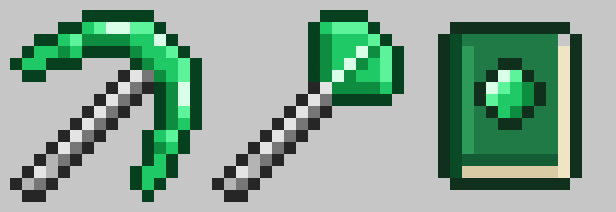

# Terraformer Tools — Minecraft Bedrock add-on

An emerald pickaxe and spade for terraforming. They mine **instantly**, **never break**, and dig a **1 × 1, 2 × 2 or 3 × 3** area with every block you break. A guide book in game explains everything.



Built on the stable Script API — `@minecraft/server` 2.9.0 and `@minecraft/server-ui` 2.1.0 (Minecraft Bedrock 1.26.40 or newer). No experimental toggles needed. Works on PS5, Xbox, Switch, Windows, iOS and Android.

## The tools

| | Terraformer Pickaxe | Terraformer Spade |
|---|---|---|
| Digs | stone, ores, deepslate, netherrack, metal blocks, rails — anything a pickaxe mines | dirt, grass, sand, gravel, clay, snow, soul sand — anything a shovel mines |
| Speed | instant | instant |
| Durability | none — never breaks | none — never breaks |
| Harvest level | diamond (obsidian and ancient debris drop) | diamond |
| Area | 1 × 1, 2 × 2 or 3 × 3 (starts at 3 × 3) | 1 × 1, 2 × 2 or 3 × 3 (starts at 3 × 3) |

### Changing the size

Hold the tool, **sneak and press Use**, then pick a size from the menu.

| Device | Sneak + Use |
|---|---|
| PS5 / controller | hold sneak (R3 by default) + press L2 |
| PC | hold Shift + right-click |
| Touch | tap sneak, then tap and hold the screen |

Each tool remembers its own size, shown in its description (e.g. *Mining area: 2 × 2*). Use the tool **without** sneaking to see its current size on screen.

### Where the area goes

The area is a flat square on the face of the block you hit:

- **3 × 3** — centred on the block you hit.
- **2 × 2** — the block you hit, plus the blocks above it and to your right. On floors and ceilings it spreads to your right and away from you.
- **1 × 1** — just that block, like a normal tool.

Dig into a wall for a tunnel, dig straight down for a shaft, or dig the ground to flatten it.

### Safety rules

- The pickaxe's area only takes pickaxe blocks, and the spade's only takes spade blocks. Chests, logs, glass, builds next to your work stay where they are. If you hit a block the tool isn't meant for (dirt with the pickaxe, say), only that block breaks.
- Bedrock, portals and portal frames, barriers, command and structure blocks, light blocks and reinforced deepslate are never touched.
- Water and lava aren't removed.
- Blocks broken by the area drop their items like normal mining. In Creative nothing drops.

## Recipes

Crafting table, top row first. **E** = Emerald, **I** = Iron Ingot.

| Terraformer Pickaxe | Terraformer Spade |
|---|---|
| `E E E` | `· E ·` |
| `· I ·` | `· I ·` |
| `· I ·` | `· I ·` |

**Terraformer Tools Guide:** Book + Emerald, shapeless (any slots).

All three items are also in the creative inventory (Equipment tab).

## The guide book

Every player gets a **Terraformer Tools Guide** the first time they join a world with the add-on. Use it to open a chaptered menu:

1. **The tools** — what they dig and what makes them special
2. **Changing the size** — the sneak + use menu, with PS5, PC and touch controls
3. **Where the area goes** — how 1 × 1, 2 × 2 and 3 × 3 are aimed
4. **Crafting recipes** — the pickaxe, spade and guide recipes
5. **Good to know** — drops, protected blocks, water and lava

## Installing

### Build the `.mcaddon`

```sh
python3 tools/build.py        # → dist/Terraformer_Tools.mcaddon
```

### On a phone, tablet or Windows PC

Open `Terraformer_Tools.mcaddon` — Minecraft imports both packs. Then, in a world's settings, turn on **Behavior Packs → Terraformer Tools** (the resource pack is added automatically; if not, turn on **Resource Packs → Terraformer Tools Resources** too).

### On PS5 (or other consoles)

Consoles can't import `.mcaddon` files directly, so the add-on has to arrive with a world:

1. **Realm (easiest):** import the `.mcaddon` on a phone, tablet or PC, create a world with both packs active, then use *Realm settings → Replace world* to upload it. Join the Realm from your PS5 and the packs download automatically. To add it to an existing Realm world, download the Realm world on that device, activate the packs on it, and upload it back.
2. **Host from another device:** host the world with the packs on a phone or PC and join it from the PS5 as a friend.

Like all add-ons, turning it on disables achievements for that world.

## Files

```
Terraformer_Tools_BP/            behavior pack
  manifest.json
  items/                         pickaxe, spade and guide item definitions
  recipes/                       the three crafting recipes
  scripts/main.js                wires game events to the features below
  scripts/tools.js               tool definitions, size setting, which blocks may be dug
  scripts/mining.js              the 2 × 2 / 3 × 3 area mining
  scripts/size_menu.js           sneak + use size picker
  scripts/guide.js               guide book chapters and first-join gift
Terraformer_Tools_RP/            resource pack
  textures/items/                16 × 16 item textures
  textures/ui/                   size icons for the menu
  texts/en_US.lang               item names
tools/render_textures.py         draws every texture (python3 + Pillow)
tools/build.py                   zips both packs into dist/Terraformer_Tools.mcaddon
```

## How it works

- **Instant mining:** each tool's `minecraft:digger` gives a dig speed of 10,000 on its block types — fast enough to break even obsidian in a single tick.
- **No durability:** the items have no `minecraft:durability` component, so there is nothing to wear out.
- **Area mining:** on `world.beforeEvents.playerBreakBlock` the script reads the tool's size, finds the face you hit with `getBlockFromViewDirection`, and on the next tick breaks the rest of the square with `setblock … air destroy` so drops and break effects match normal mining.
- **Size setting:** stored on the item itself as a dynamic property (`terraformer:size`), so every tool keeps its own setting, even when traded or put in a chest.

## Changing things

- **Bigger areas:** add sizes to `SIZES` in `scripts/tools.js` (e.g. `[1, 2, 3, 5]`) and a matching `textures/ui/terraformer_size_5.png`.
- **Default size:** change `DEFAULT_SIZE` in `scripts/tools.js`.
- **Protected blocks:** add IDs to `NEVER_BREAK` in `scripts/tools.js`.
- **Artwork:** edit `tools/render_textures.py` and run it to redraw every texture.
